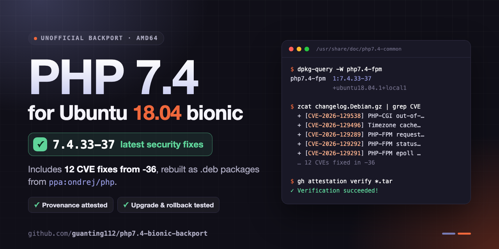

# PHP 7.4 for Ubuntu 18.04 (bionic)

[](https://github.com/guanting112/php7.4-bionic-backport/actions/workflows/release.yml)
[](https://github.com/guanting112/php7.4-bionic-backport/releases/latest)
[](https://github.com/guanting112/php7.4-bionic-backport/attestations)


English | [繁體中文](README.zh-TW.md)



Unofficial rebuilds of the `php7.4` packages from [Ondřej Surý's PPA](https://launchpad.net/~ondrej/+archive/ubuntu/php) for **Ubuntu 18.04 LTS (bionic), amd64**.

Every release is built and tested in public by [GitHub Actions](.github/workflows/release.yml), and comes with a signed build provenance attestation that you can verify.

> [!IMPORTANT]
> **Use `7.4.33-37`. It already includes the latest PHP 7.4 security fixes.**
> It contains every fix that ppa:ondrej/php had backported to PHP 7.4.33 as of `-37`. Among them:
>
> - **12 CVEs fixed in `-36`** (from PHP 8.2.36). They include remote code execution through sessions and the timezone cache, PHP-FPM request smuggling and privilege escalation, PHP-CGI out-of-bounds access, a PHAR signature bypass and SOAP flaws.
> - **CVE-2024-11235**, fixed in `-32`: a use-after-free in `php_request_shutdown`.
>
> For the full list, see [What changed from -31 to -37](#what-changed-from--31-to--37).

## Download and verify

Use **`7.4.33-37`**. `7.4.33-31` is kept only as a rollback target and does not have the security fixes above.

On the 18.04 server:

```bash
V=7.4.33-37
wget "https://github.com/guanting112/php7.4-bionic-backport/releases/download/$V/php7.4-bionic-$V-amd64.tar"
tar xf "php7.4-bionic-$V-amd64.tar"
cd "php7.4-bionic-$V"
sha256sum -c SHA256SUMS
```

To verify where the file came from, run this on any machine with the [GitHub CLI](https://cli.github.com/). The server itself doesn't need it.

```bash
gh attestation verify php7.4-bionic-7.4.33-37-amd64.tar --repo guanting112/php7.4-bionic-backport
```

A successful check proves that the file was built by this repository's workflow, from a specific commit, on GitHub's runners. The output links to the commit and the workflow run, where you can read the full build log. Nobody's personal machine is involved in building released files.

If you plan to upgrade, also download the `7.4.33-31` tarball now. Then you can roll back even if the server can't reach GitHub.

Run the commands below in **bash**, Ubuntu's default shell. In zsh, `$pk` is not split into separate words; write `${=pk}` instead.

## Upgrade an existing PHP 7.4 install

This works on servers that already have php7.4, for example the last PPA builds for bionic or an older release from this repository.
It upgrades only the packages already installed on the server and never adds new ones, so you can run the same steps on every server.

```bash
cd php7.4-bionic-7.4.33-37
sha256sum -c SHA256SUMS

# php7.4-common requires php-common >= 1:81~
dpkg --compare-versions "$(dpkg-query -W -f='${Version}' php-common)" ge 1:81~ && echo "php-common OK"
# No "php-common OK"? Install the bundled one first (see Notes > php-common):
#   sudo apt-get install ./php-common_*.deb

# Back up the configuration
sudo cp -a /etc/php/7.4 /root/etc-php-7.4.bak-$(date +%F)

# Select only the packages that are already installed on this server
pk=$(for f in *.deb; do n=${f%%_*}; [ "$n" = php-common ] && continue; dpkg-query -W -f='${Status}' "$n" 2>/dev/null | grep -q 'ok installed' && echo "./$f"; done)
echo "$pk"

sudo UCF_FORCE_CONFFOLD=1 apt-get install -o Dpkg::Options::=--force-confold $pk

dpkg-query -W php7.4-cli php7.4-fpm      # expect 1:7.4.33-37+ubuntu18.04.1+local1
sudo php-fpm7.4 -t && sudo systemctl status php7.4-fpm --no-pager
```

- `UCF_FORCE_CONFFOLD=1` and `--force-confold` keep your edited `php.ini`, `www.conf` and other config files, and stop the config-file prompts.
- Before you confirm, read apt's summary. It should only list upgrades, with nothing to remove.
- php-fpm restarts during the upgrade, and so does Apache if you use `libapache2-mod-php7.4`. Expect a short interruption.
- Upgrade one server first, check your sites, then do the rest.

## Fresh install (no PHP yet)

```bash
cd php7.4-bionic-7.4.33-37
sha256sum -c SHA256SUMS
sudo apt-get update
sudo apt-get install ./php-common_*.deb \
  ./php7.4-{common,json,opcache,readline,cli,fpm,mysql,mbstring,xml,curl,gd,zip,bcmath,intl}_*.deb
```

Add or remove extensions from the `{…}` list as needed. apt installs the remaining dependencies from the Ubuntu 18.04 archive.

## Roll back to -31

Download and unpack the `7.4.33-31` tarball the same way as above, with `V=7.4.33-31`. Then:

```bash
cd php7.4-bionic-7.4.33-31
sha256sum -c SHA256SUMS
pk=$(for f in *.deb; do n=${f%%_*}; [ "$n" = php-common ] && continue; dpkg-query -W -f='${Status}' "$n" 2>/dev/null | grep -q 'ok installed' && echo "./$f"; done)
echo "$pk"
sudo UCF_FORCE_CONFFOLD=1 apt-get install --allow-downgrades -o Dpkg::Options::=--force-confold $pk

dpkg-query -W php7.4-cli php7.4-fpm      # expect 1:7.4.33-31+ubuntu18.04.1+local1
sudo php-fpm7.4 -t && sudo systemctl status php7.4-fpm --no-pager
```

## Which build am I running?

`php -v` prints only `PHP 7.4.33`, without the `-NN` revision. The packaging tries to patch `EXTRA_VERSION` in `configure.ac`, but PHP 7.4's `configure.ac` no longer has that line, so the patch has no effect.

Use either of these instead:

- `dpkg-query -W php7.4-cli php7.4-fpm`
- The `built:` time in `php -v`. Each release lists it in its notes and in `BUILD-INFO.txt`.

Because the version in `php -v` never changes, vulnerability scanners that only compare version numbers may keep reporting CVEs that `-37` has already fixed. To see which fixes are installed, read the changelog: `zcat /usr/share/doc/php7.4-common/changelog.Debian.gz | less`.

## Versions

| Release | Package version | Rebuilt from | Use it for |
|---|---|---|---|
| [`7.4.33-37`](https://github.com/guanting112/php7.4-bionic-backport/releases/tag/7.4.33-37) | `1:7.4.33-37+ubuntu18.04.1+local1` | `1:7.4.33-37+ubuntu22.04.1+deb.sury.org+1` | **Recommended.** New installs and upgrades |
| [`7.4.33-31`](https://github.com/guanting112/php7.4-bionic-backport/releases/tag/7.4.33-31) | `1:7.4.33-31+ubuntu18.04.1+local1` | `1:7.4.33-31+ubuntu22.04.1+deb.sury.org+1` | Rollback target only. Doesn't have the fixes from `-32` to `-37` |

Each release contains:

| File | Contents |
|---|---|
| `php7.4-bionic-7.4.33-NN-amd64.tar` | Everything below in one file. **Download this one.** |
| `*.deb` | All 38 binary packages built from the `php7.4` source (`cli`, `fpm`, `cgi`, `libapache2-mod-php7.4`, `dev` and every extension), plus `php-common`. Debug symbol packages are not included. |
| `SHA256SUMS` | Checksums of the `.deb` files |
| `BUILD-INFO.txt` | Package version, source version, `php -v` output, git commit and workflow run |
| `*.buildinfo`, `*.changes` | Debian build metadata |

The `.deb` files are also attached one by one, but GitHub renames assets that contain `~`: `php-common_101~+…` becomes `php-common_101.+…`, which no longer matches `SHA256SUMS`. The tarball keeps the original names, so use it.

### What changed from -31 to -37

From the Debian changelog (`zcat /usr/share/doc/php7.4-common/changelog.Debian.gz`):

| Revision | Changes |
|---|---|
| `-32` | Fix for a segfault in `fpm_status_export_to_zval` (from 8.1.27). Fix for CVE-2024-11235, a use-after-free in `php_request_shutdown` (from 8.3.19). |
| `-33` | `openssl_csr_get_public_key()` no longer returns the private key with OpenSSL 3. `imagetruecolortopalette()` no longer uses libimagequant. Test suite fixes. |
| `-34` | imap `utf8_to_mutf7()` configure check fixed. `enchant_dict_is_in_session()` kept as an alias. |
| `-35` | Multiple fixes in `fpm_get_status()`. |
| `-36` | **12 security fixes from 8.2.36** in PHP-CGI, PHP-FPM, sessions, PHAR, SOAP and the HTTP/FTP stream wrappers. |
| `-37` | The upstream test suite runs under autopkgtest instead of during the build. No code changes. |

<details>
<summary>CVEs fixed in -36</summary>

As listed in the changelog:

- CVE-2026-129538: PHP-CGI out-of-bounds read and write during `PATH_INFO` correction
- CVE-2026-129496: timezone cache use-after-free can lead to remote code execution
- CVE-2026-129289: PHP-FPM request smuggling through an unread HTTP request body
- CVE-2026-129292: PHP-FPM status endpoint XSS via unescaped user and script fields
- CVE-2026-129291: PHP-FPM epoll use-after-free can lead to local privilege escalation
- CVE-2026-128090: PHAR OpenSSL signature bypass via algorithm downgrade
- CVE-2026-126714: partially overwritten session files can lead to remote code execution
- CVE-2026-115560: session serializer mismatch can lead to remote code execution
- CVE-2026-15353: SOAP information disclosure through malformed array dimensions
- CVE-2026-129506: SOAP use-after-free when processing DTD entity references
- CVE-2026-128064: mixed-case HTTPS and FTPS URLs can expose data in plaintext
- CVE-2026-127960: denial of service through folded HTTP response headers

</details>

## Why this exists

- The PPA (`ppa:ondrej/php`) no longer publishes php7.4 for bionic (18.04) or focal (20.04).
- It still ships backported security fixes for PHP 7.4.33 on jammy (22.04) and newer, as `1:7.4.33-NN`.
- This project takes the **unmodified** jammy source package and rebuilds it inside an `ubuntu:18.04` container. Only the version number changes; the source, `debian/control` and patches are untouched.
- The resulting packages link against the 18.04 libraries (`libssl1.1`, `libsodium23`, …) and install with plain `apt-get`.

## How releases are built and tested

[`.github/workflows/release.yml`](.github/workflows/release.yml) runs when the maintainer starts it by hand. For each revision it:

1. Runs [`build-php74-bionic.sh`](build-php74-bionic.sh) on a GitHub-hosted runner.
2. Runs [`tests/fresh-install.sh`](tests/fresh-install.sh) in a clean `ubuntu:18.04` container: a fresh install with the bundled `php-common`.
3. Creates the tarball and a build provenance attestation for it and for every `.deb`. You can check these with [`gh attestation verify`](https://cli.github.com/manual/gh_attestation_verify).

When two or more revisions are built together, it also runs [`tests/upgrade-rollback.sh`](tests/upgrade-rollback.sh) from the oldest to the newest:

- Install the old revision, including `libapache2-mod-php7.4` and the `php7.4` metapackage.
- Edit `php.ini` and `www.conf`.
- Upgrade, then roll back, with the exact commands from this README.
- Fail if an edited setting is lost, a config-file prompt appears, or apt removes anything.

After each step, the tests check:

- the installed package versions
- `php -v`
- `php-fpm7.4 -t` reports `test is successful`
- mbstring, gd, curl, bcmath, pdo_mysql, intl and `password_hash(PASSWORD_ARGON2ID)` all work

A release is published only if every step passes.

## Notes

### php-common

- `php7.4-common` requires `php-common (>= 1:81~)`.
- dpkg compares the epoch (the number before `:`) first, so any `php-common` with epoch `2:` is new enough.
- The bundled `php-common_101~+ubuntu18.04.1+local1_all.deb` is for servers without a usable one, such as a fresh 18.04 install or one that only has Ubuntu's own `1:60ubuntu1`.
- Do **not** install it over the PPA's `2:101~+ubuntu22.04.1+deb.sury.org+1`. `ubuntu18.04` sorts lower than `ubuntu22.04`, so it would be a downgrade.
- The bundled `php-common` declares `Breaks:` on old builds of PECL packages such as `php-imagick` and `php-redis`. If apt offers to remove them, that is the reason.
- Rebuilding `php-defaults` also produces `php`, `php-cli`, `php-mysql` and other metapackages. They point at PHP 8.x, so the releases include only `php-common`.

### PECL extensions

Extensions you compiled with `pecl` (for example `imagick.so`) don't need recompiling between 7.4.33 revisions. They all share PHP API `20190902`.
Websites run through FPM, which loads its own `conf.d`, so check with `sudo php-fpm7.4 -m`, not `php -m`.

## Build it yourself

You need:

- An amd64 machine running Ubuntu 22.04 or 24.04. Any release that can run Docker will do, because the build runs inside `ubuntu:18.04` and the host release doesn't affect the result.
- Root access. The script installs `docker.io` if it is missing.
- About 15 minutes on 8 cores.

```bash
sudo ./build-php74-bionic.sh                      # latest revision on the PPA
sudo PHP74_REVISION=31 ./build-php74-bionic.sh    # a specific revision
sudo SOURCE_ONLY=1 ./build-php74-bionic.sh        # only download and verify the source
# Packages and SHA256SUMS are written to /root/php74-bionic-debs/ (set OUT_DIR to change it)
```

What the script does inside the `ubuntu:18.04` container:

1. Fetches the PPA signing key and checks its fingerprint.
2. Adds the PPA's jammy `deb-src` and runs `apt-get source php7.4`. apt verifies the source through the signed index.
3. Fetches the `.dsc` signing key and checks that it signed this apt-verified `.dsc`.
4. For an older revision, which the index no longer lists, downloads its `.dsc` and files from the PPA pool.
5. Extracts the source with `dpkg-source --require-valid-signature`, which checks the `.dsc` signature and every file's checksum.
6. Runs `apt-get build-dep ./`. Every build dependency is available on 18.04.
7. Runs `dch -b -v '1:7.4.33-NN+ubuntu18.04.1+local1' -D bionic`.
8. Runs `DEB_BUILD_OPTIONS="parallel=$(nproc) nocheck" dpkg-buildpackage -b -us -uc`.
9. Repeats the build for `php-defaults` to produce `php-common`.

The changelog entry is signed `Local backport build <root@localhost>` so that no personal details end up in the packages.

| Key | Fingerprint |
|---|---|
| PPA archive signing key (`InRelease`) | `14AA40EC0831756756D7F66C4F4EA0AAE5267A6C` |
| `.dsc` signing key (Ondřej Surý, Automated PPA Upload Key) | `6A1AAD7AE5B401C6E259A7B257067BAA1314C7FC` |

### Build gotchas

- **`dch` rejects the new version** with `New version … is less than the current version`. `ubuntu18.04` sorts lower than `ubuntu22.04`, so pass `-b`. This doesn't matter on 18.04 servers, which never see the 22.04 packages.
- **`apt-get source` warns `Download is performed unsandboxed as root`.** This is harmless.
- **apt can no longer find bionic.** If `archive.ubuntu.com` ever drops it, point the container's sources at `old-releases.ubuntu.com`.
- **The build passes `nocheck`.** Since `-37`, the packaging runs the upstream test suite under autopkgtest instead of at build time.

## For maintainers: publishing a release

1. Check the newest php7.4 revision on the PPA:

   ```bash
   curl -s https://ppa.launchpadcontent.net/ondrej/php/ubuntu/dists/jammy/main/source/Sources.gz \
     | gunzip | awk '/^Package: php7\.4$/{f=1} f&&/^Version:/{print $2; exit}'
   ```

2. Open **Actions → Build and release → Run workflow**.
3. Fill in the revisions, separated by spaces, for example `31 37`. Leave the field empty to build the latest. Building two or more also runs the upgrade and rollback test between the oldest and the newest.
4. Wait for the run to finish, about 15 minutes. The revisions build in parallel, and each build takes about 11 minutes.

Notes:

- The repository must be public, because artifact attestations aren't available for private repositories on GitHub's free plans.
- An existing release is never overwritten. To rebuild one, delete the release and its tag first.
- Only the PPA's current revision is marked as the latest release.

## Disclaimer

- This is an **unofficial** rebuild. It is not affiliated with or endorsed by Ondřej Surý, the PHP project, Debian or Canonical. Please don't report problems with these builds to them.
- PHP 7.4 reached upstream end of life on 2022-11-28, and Ubuntu 18.04 standard support ended on 2023-05-31. Treat these packages as a stopgap while you plan a migration.
- They are provided as is, with no warranty. Test before deploying.
- All the packaging and security backports are the work of Ondřej Surý and the Debian PHP team. If these packages help you, consider supporting their work: <https://deb.sury.org/>.

PHP is distributed under the PHP License 3.01. The license of each package is in `/usr/share/doc/<package>/copyright`.

## Repository layout

```
build-php74-bionic.sh           Build script (runs the build in an ubuntu:18.04 container)
tests/                          Install tests run by CI in clean ubuntu:18.04 containers
.github/workflows/release.yml   Build, test, attest and publish releases
.github/social-preview.*        Cover image and its HTML source
```

The `.deb` files are published only as release assets, never committed to git.
