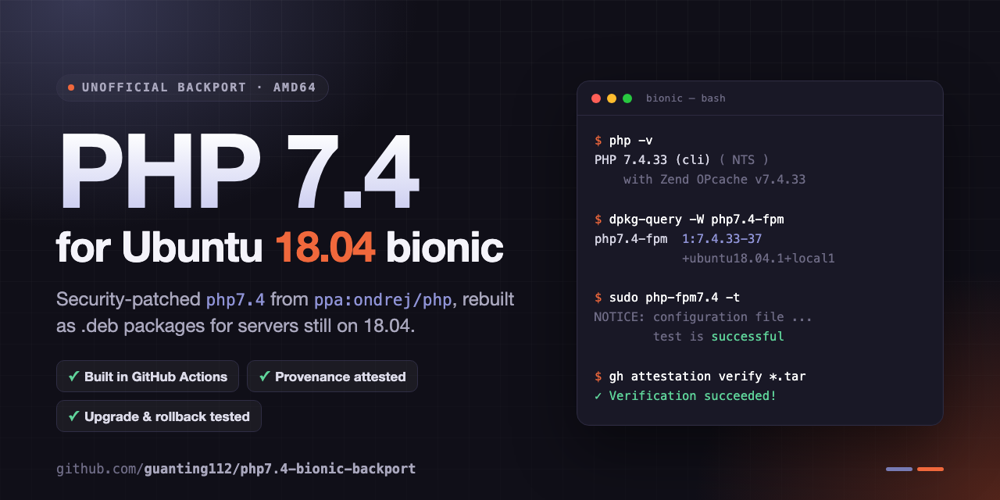

# PHP 7.4 for Ubuntu 18.04 (bionic)

[](https://github.com/guanting112/php7.4-bionic-backport/actions/workflows/release.yml)
[](https://github.com/guanting112/php7.4-bionic-backport/releases/latest)
[](https://github.com/guanting112/php7.4-bionic-backport/attestations)


[English](README.md) | 繁體中文



把 [Ondřej Surý PPA](https://launchpad.net/~ondrej/+archive/ubuntu/php) 的 `php7.4` 套件，重新編譯給 **Ubuntu 18.04 LTS (bionic)、amd64** 使用。這是非官方的版本。

每個版本都由 [GitHub Actions](.github/workflows/release.yml) 公開編譯和測試，並附上可以自行驗證的 build provenance attestation（建置來源證明）。

## 下載和驗證

沒有特別原因的話，請用 `7.4.33-37`。`7.4.33-31` 留著給退版用，兩版的差異見 [提供的版本](#提供的版本)。

在 18.04 主機上：

```bash
V=7.4.33-37
wget "https://github.com/guanting112/php7.4-bionic-backport/releases/download/$V/php7.4-bionic-$V-amd64.tar"
tar xf "php7.4-bionic-$V-amd64.tar"
cd "php7.4-bionic-$V"
sha256sum -c SHA256SUMS
```

要確認檔案的來源，在任何一台裝了 [GitHub CLI](https://cli.github.com/) 的電腦上執行下面的指令，主機本身不用裝：

```bash
gh attestation verify php7.4-bionic-7.4.33-37-amd64.tar --repo guanting112/php7.4-bionic-backport
```

驗證通過代表這個檔案是本 repo 的 workflow，在 GitHub 的機器上，從某個特定 commit 編出來的。
輸出裡會附上 commit 和 workflow 執行紀錄的連結，完整的編譯 log 都看得到。發佈的檔案不是在任何人自己的電腦上編的。

如果要升級，建議**同時下載 `7.4.33-31`**。這樣就算主機連不到 GitHub，也還能退版。

下面的指令請用 **bash** 執行（Ubuntu 預設就是 bash）。zsh 不會把 `$pk` 拆成多個參數，要改寫成 `${=pk}`。

## 升級現有的 PHP 7.4

適用於已經裝了 php7.4 的主機，例如 PPA 最後一批給 18.04 的版本，或本 repo 較舊的版本。
指令只會升級這台**已經裝了**的套件，不會多裝，所以每台主機都可以用同一套步驟。

```bash
cd php7.4-bionic-7.4.33-37
sha256sum -c SHA256SUMS

# php7.4-common 需要 php-common >= 1:81~
dpkg --compare-versions "$(dpkg-query -W -f='${Version}' php-common)" ge 1:81~ && echo "php-common OK"
# 沒有印出 "php-common OK" 的話，先裝附的 php-common（見下方「注意事項」）：
#   sudo apt-get install ./php-common_*.deb

# 備份設定檔
sudo cp -a /etc/php/7.4 /root/etc-php-7.4.bak-$(date +%F)

# 只挑這台主機已經裝了的套件
pk=$(for f in *.deb; do n=${f%%_*}; [ "$n" = php-common ] && continue; dpkg-query -W -f='${Status}' "$n" 2>/dev/null | grep -q 'ok installed' && echo "./$f"; done)
echo "$pk"

sudo UCF_FORCE_CONFFOLD=1 apt-get install -o Dpkg::Options::=--force-confold $pk

dpkg-query -W php7.4-cli php7.4-fpm      # 要看到 1:7.4.33-37+ubuntu18.04.1+local1
sudo php-fpm7.4 -t && sudo systemctl status php7.4-fpm --no-pager
```

- `UCF_FORCE_CONFFOLD=1` 和 `--force-confold` 會保留你改過的 `php.ini`、`www.conf` 等設定檔，也不會跳出設定檔詢問。
- 按下確認前，先看 apt 列出的清單：應該只有升級，沒有要移除的套件。
- 升級時 php-fpm 會重啟，有用 `libapache2-mod-php7.4` 的話 Apache 也會重啟，會有短暫中斷。
- 建議先升一台，確認網站正常再升其他台。

## 全新安裝

主機上還沒有 PHP 時：

```bash
cd php7.4-bionic-7.4.33-37
sha256sum -c SHA256SUMS
sudo apt-get update
sudo apt-get install ./php-common_*.deb \
  ./php7.4-{common,json,opcache,readline,cli,fpm,mysql,mbstring,xml,curl,gd,zip,bcmath,intl}_*.deb
```

`{…}` 裡的擴充可以依需要增減，其他相依套件 apt 會從 Ubuntu 18.04 的套件庫自動安裝。

## 退回 -31

照上面「下載和驗證」的步驟，把 `V` 改成 `7.4.33-31`，下載並解開 tarball，然後：

```bash
cd php7.4-bionic-7.4.33-31
sha256sum -c SHA256SUMS
pk=$(for f in *.deb; do n=${f%%_*}; [ "$n" = php-common ] && continue; dpkg-query -W -f='${Status}' "$n" 2>/dev/null | grep -q 'ok installed' && echo "./$f"; done)
echo "$pk"
sudo UCF_FORCE_CONFFOLD=1 apt-get install --allow-downgrades -o Dpkg::Options::=--force-confold $pk

dpkg-query -W php7.4-cli php7.4-fpm      # 要看到 1:7.4.33-31+ubuntu18.04.1+local1
sudo php-fpm7.4 -t && sudo systemctl status php7.4-fpm --no-pager
```

## 怎麼確認目前裝的是哪一版

`php -v` 只會顯示 `PHP 7.4.33`，看不到 `-NN`。
這是因為打包時會去改 `configure.ac` 的 `EXTRA_VERSION`，但 PHP 7.4 的 `configure.ac` 已經沒有這一行，所以改不到。

請改用下面任一種方法：

- `dpkg-query -W php7.4-cli php7.4-fpm`
- 看 `php -v` 的 `built:` 時間。每個 Release 的說明和 `BUILD-INFO.txt` 都有列出。

## 提供的版本

| Release | 套件版號 | 來源 | 用途 |
|---|---|---|---|
| [`7.4.33-37`](https://github.com/guanting112/php7.4-bionic-backport/releases/tag/7.4.33-37) | `1:7.4.33-37+ubuntu18.04.1+local1` | `1:7.4.33-37+ubuntu22.04.1+deb.sury.org+1` | **建議使用**，全新安裝和升級 |
| [`7.4.33-31`](https://github.com/guanting112/php7.4-bionic-backport/releases/tag/7.4.33-31) | `1:7.4.33-31+ubuntu18.04.1+local1` | `1:7.4.33-31+ubuntu22.04.1+deb.sury.org+1` | 退版用 |

每個 Release 裡有：

| 檔案 | 內容 |
|---|---|
| `php7.4-bionic-7.4.33-NN-amd64.tar` | 下面所有檔案打包成一個檔。**下載這個就好。** |
| `*.deb` | `php7.4` 原始碼編出的全部 38 個套件（`cli`、`fpm`、`cgi`、`libapache2-mod-php7.4`、`dev` 和所有擴充），加上 `php-common`。不含除錯符號套件。 |
| `SHA256SUMS` | 所有 `.deb` 的 checksum |
| `BUILD-INFO.txt` | 套件版號、來源版號、`php -v` 的輸出、git commit、workflow 執行紀錄 |
| `*.buildinfo`、`*.changes` | Debian 的編譯資訊 |

### -31 到 -37 改了什麼

整理自 Debian changelog（`zcat /usr/share/doc/php7.4-common/changelog.Debian.gz`）：

| 版本 | 內容 |
|---|---|
| `-32` | 修正 `fpm_status_export_to_zval` 的 segfault（來自 8.1.27）。修正 CVE-2024-11235，`php_request_shutdown` 的 use-after-free（來自 8.3.19）。 |
| `-33` | 修正 OpenSSL 3 下 `openssl_csr_get_public_key()` 會回傳私鑰的問題。`imagetruecolortopalette()` 不再使用 libimagequant。修正測試。 |
| `-34` | 修正 imap `utf8_to_mutf7()` 的 configure 檢查。保留 `enchant_dict_is_in_session()` 別名。 |
| `-35` | 修正 `fpm_get_status()` 的多個問題。 |
| `-36` | **從 8.2.36 移植 12 個安全修補**，涵蓋 PHP-CGI、PHP-FPM、session、PHAR、SOAP，以及 HTTP/FTP stream wrapper。 |
| `-37` | 上游測試改到 autopkgtest 跑，不在編譯時跑。程式碼沒有變動。 |

<details>
<summary>-36 修補的 CVE</summary>

以 changelog 的原文為準：

- CVE-2026-129538：PHP-CGI 修正 `PATH_INFO` 時越界讀寫
- CVE-2026-129496：時區快取 use-after-free，可能導致遠端執行程式碼
- CVE-2026-129289：PHP-FPM 透過未讀取的 HTTP request body 進行 request smuggling
- CVE-2026-129292：PHP-FPM status 頁面沒有跳脫 user 和 script 欄位，造成 XSS
- CVE-2026-129291：PHP-FPM epoll use-after-free，可能導致本機權限提升
- CVE-2026-128090：PHAR OpenSSL 簽章可透過演算法降級繞過
- CVE-2026-126714：session 檔案被部分覆寫時，可能導致遠端執行程式碼
- CVE-2026-115560：session serializer 不一致，可能導致遠端執行程式碼
- CVE-2026-15353：SOAP 處理格式錯誤的陣列維度時洩漏資訊
- CVE-2026-129506：SOAP 處理 DTD entity reference 時 use-after-free
- CVE-2026-128064：大小寫混用的 HTTPS、FTPS 網址可能以明文傳送資料
- CVE-2026-127960：折行的 HTTP response header 造成阻斷服務

</details>

## 為什麼要做這個

- PPA（`ppa:ondrej/php`）已經不再為 18.04 和 20.04 出 php7.4。
- 但 22.04 以上還持續有 PHP 7.4.33 的安全修補，版號是 `1:7.4.33-NN`。
- 這個專案把 PPA 22.04 的原始碼套件**原封不動**，放進 `ubuntu:18.04` 容器重新編譯。除了版號，原始碼、`debian/control` 和 patch 都沒有改。
- 編出來的套件連結的是 18.04 的函式庫（`libssl1.1`、`libsodium23`…），可以直接用 `apt-get` 安裝。

## 編譯和測試流程

[`.github/workflows/release.yml`](.github/workflows/release.yml) 由維護者手動執行，每個版本會做這些事：

1. 在 GitHub 的機器上執行 [`build-php74-bionic.sh`](build-php74-bionic.sh)。
2. 在乾淨的 `ubuntu:18.04` 容器裡跑 [`tests/fresh-install.sh`](tests/fresh-install.sh)，用附的 `php-common` 做全新安裝。
3. 打包 tarball，並替 tarball 和每個 `.deb` 產生 build provenance attestation，可以用 [`gh attestation verify`](https://cli.github.com/manual/gh_attestation_verify) 檢查。

同時編兩個以上的版本時，還會跑 [`tests/upgrade-rollback.sh`](tests/upgrade-rollback.sh)，從最舊升到最新再退回：

- 先裝舊版，包含 `libapache2-mod-php7.4` 和 `php7.4` metapackage。
- 修改 `php.ini` 和 `www.conf`。
- 用這份 README 裡**一模一樣的指令**升級，再退版。
- 只要有改過的設定不見、跳出設定檔詢問，或 apt 移除了任何套件，就算失敗。

每一步做完都會檢查：

- 安裝的套件版號
- `php -v`
- `php-fpm7.4 -t` 顯示 `test is successful`
- mbstring、gd、curl、bcmath、pdo_mysql、intl、`password_hash(PASSWORD_ARGON2ID)` 都正常

全部通過才會發佈 Release。

## 注意事項

### php-common

- `php7.4-common` 需要 `php-common (>= 1:81~)`。
- dpkg 比版號時會先比冒號前的 epoch，所以只要是 `2:` 開頭的 `php-common` 就夠用。
- 附的 `php-common_101~+ubuntu18.04.1+local1_all.deb`，只給沒有合用 `php-common` 的主機。例如全新的 18.04，或只有 Ubuntu 自己的 `1:60ubuntu1`。
- 已經裝了 PPA 的 `2:101~+ubuntu22.04.1+deb.sury.org+1`，就**不要**再裝附的這個。`ubuntu18.04` 依字串排序比 `ubuntu22.04` 小，裝了等於降版。
- 附的 `php-common` 對舊版的 PECL 套件（例如 `php-imagick`、`php-redis`）宣告了 `Breaks:`。如果 apt 說要移除它們，原因就在這裡。
- 重編 `php-defaults` 也會產出 `php`、`php-cli`、`php-mysql` 等 metapackage。它們指向 PHP 8.x，所以 Release 裡只放 `php-common`。

### PECL 擴充

用 `pecl` 自己編的擴充（例如 `imagick.so`），在 7.4.33 各版之間不用重編，因為 PHP API 版本都是 `20190902`。
網站走的是 fpm，fpm 有自己的 `conf.d`，所以要用 `sudo php-fpm7.4 -m` 檢查，不是 `php -m`。

## 自己編譯

需要：

- 一台 amd64、Ubuntu 22.04 或 24.04 的機器。其實只要能跑 Docker 都可以，因為編譯是在 `ubuntu:18.04` 容器裡進行，跟主機是哪一版無關。
- root 權限。沒有 Docker 的話，script 會自己裝 `docker.io`。
- 8 核心約 15 分鐘。

```bash
sudo ./build-php74-bionic.sh                      # PPA 上最新的版本
sudo PHP74_REVISION=31 ./build-php74-bionic.sh    # 指定版本
sudo SOURCE_ONLY=1 ./build-php74-bionic.sh        # 只下載並驗證原始碼，不編譯
# 產出在 /root/php74-bionic-debs/（可用 OUT_DIR 指定）
```

script 在 `ubuntu:18.04` 容器裡會做這些事：

1. 下載 PPA 的簽章金鑰，檢查指紋。
2. 加入 PPA 的 jammy `deb-src`，執行 `apt-get source php7.4`。apt 會透過有簽章的套件清單驗證原始碼。
3. 下載 `.dsc` 的簽章金鑰，確認這份 apt 驗證過的 `.dsc` 是它簽的。
4. 要編舊版時，因為舊版已經不在套件清單裡，改從 PPA pool 下載它的 `.dsc` 和原始碼檔案。
5. 用 `dpkg-source --require-valid-signature` 解開原始碼，同時檢查 `.dsc` 簽章和每個檔案的 checksum。
6. 執行 `apt-get build-dep ./`。18.04 上所有編譯相依套件都裝得到。
7. 執行 `dch -b -v '1:7.4.33-NN+ubuntu18.04.1+local1' -D bionic`。
8. 執行 `DEB_BUILD_OPTIONS="parallel=$(nproc) nocheck" dpkg-buildpackage -b -us -uc`。
9. 用同樣方式編 `php-defaults`，產出 `php-common`。

changelog 的簽名固定是 `Local backport build <root@localhost>`，套件裡不會留下個人資料。

| 金鑰 | 指紋 |
|---|---|
| PPA 套件庫簽章（`InRelease`） | `14AA40EC0831756756D7F66C4F4EA0AAE5267A6C` |
| `.dsc` 簽章（Ondřej Surý, Automated PPA Upload Key） | `6A1AAD7AE5B401C6E259A7B257067BAA1314C7FC` |

### 編譯時會遇到的狀況

- **`dch` 拒絕新版號**，錯誤訊息是 `New version … is less than the current version`。這是因為 `ubuntu18.04` 依字串排序比 `ubuntu22.04` 小，要加 `-b`。18.04 主機上不會有 22.04 的套件，所以沒有影響。
- **`apt-get source` 出現 `Download is performed unsandboxed as root` 警告**，不影響結果。
- **apt 找不到 bionic。** 如果哪天 `archive.ubuntu.com` 移除了 bionic，把容器的套件來源改成 `old-releases.ubuntu.com`。
- **編譯時帶了 `nocheck`。** 從 `-37` 開始，上游測試改由 autopkgtest 執行，不在編譯時跑。

## 給維護者：發佈新版本

1. 查 PPA 上 php7.4 目前最新的版本：

   ```bash
   curl -s https://ppa.launchpadcontent.net/ondrej/php/ubuntu/dists/jammy/main/source/Sources.gz \
     | gunzip | awk '/^Package: php7\.4$/{f=1} f&&/^Version:/{print $2; exit}'
   ```

2. 打開 **Actions → Build and release → Run workflow**。
3. 填入要編的版本，用空白分隔，例如 `31 37`。留空就是編最新版。同時編兩個以上的版本時，會順便跑一次「最舊升到最新再退回」的測試。
4. 等它跑完，約 30 分鐘。多個版本會同時編。

注意：

- repo 必須是**公開**的。GitHub 免費方案的私人 repo 不能使用 artifact attestation。
- 已經存在的 Release 不會被覆蓋。要重編同一個版本，請先刪掉那個 Release 和它的 tag。
- 只有 PPA 目前最新的版本會被標成 Latest release。

## 免責聲明

- 這是**非官方**的重新打包，跟 Ondřej Surý、PHP 官方、Debian、Canonical 都沒有關係。這些套件有問題，請不要去回報給他們。
- PHP 7.4 已在 2022-11-28 停止官方支援，Ubuntu 18.04 的標準支援也在 2023-05-31 結束。請把這些套件當作過渡用，並盡早規劃升級。
- 不提供任何保證，上線前請自行測試。
- 打包和安全修補都是 Ondřej Surý 和 Debian PHP 團隊的成果。如果這些套件對你有幫助，請考慮支持他們：<https://deb.sury.org/>。

PHP 採用 PHP License 3.01。每個套件的授權寫在 `/usr/share/doc/<套件名稱>/copyright`。

## 目錄

```
build-php74-bionic.sh           編譯 script（在 ubuntu:18.04 容器裡編）
tests/                          CI 在乾淨的 ubuntu:18.04 容器裡跑的安裝測試
.github/workflows/release.yml   編譯、測試、產生 attestation、發佈 Release
.github/social-preview.*        封面圖和它的 HTML 原始檔
```

`.deb` 只會放在 Release 上，不會放進 git。
